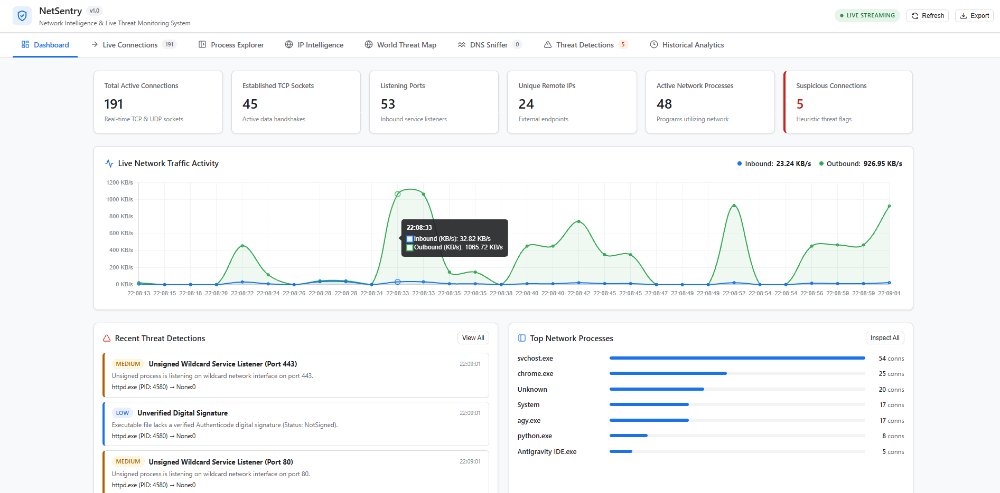

# 🛡️ NetSentry: Network Intelligence & Live Threat Monitoring System

<p align="center">
  
  
  
  
  
  
</p>

<p align="center">
  <b><i>"Enterprise-Grade Local Windows Network Intelligence & Live Threat Monitoring Platform"</i></b><br>
  Engineered by <b>Mohsin Khawaja</b> &bull; Follow on Instagram: <a href="https://www.instagram.com/csib.mohsin/"><b>@csib.mohsin</b></a><br>
  <b>Branding:</b> <code>NetSentry | DEV BY MOHSIN</code>
</p>

---

<p align="center">
  
  <br><i>NetSentry: Google Cloud-inspired live network intelligence dashboard, real-time bandwidth graph, and threat alerts</i>
</p>

---

## 🎯 Executive Overview

**NetSentry** is an industry-grade, professional local Windows network intelligence and live threat monitoring platform built from the ground up for deep socket visibility and heuristic anomaly detection. 

Combining a high-throughput **Python 3.11+ / FastAPI** backend with a Google Cloud-inspired clean light-theme dashboard (**HTML5, CSS3, Vanilla JS, Chart.js**), NetSentry continuously tracks TCP/UDP connections, correlates running processes, performs rule-based threat analysis, enriches remote endpoints with IP intelligence & ASN attribution, and maintains persistent historical connection audit trails in SQLite.

NetSentry executes **100% locally** on Windows with zero external telemetry and zero mandatory cloud dependencies.

```
                               NETSENTRY ARCHITECTURE & WORKFLOW
                               
  +-------------------------------------------------------------------------------+
  |                        WINDOWS OPERATING SYSTEM KERNEL                        |
  |  - Active TCP / UDP Sockets (psutil net_connections)                          |
  |  - Process Table (PID, PPID, Binary Paths, Authenticode Signatures, CPU/RAM)  |
  +-------------------------------------------------------------------------------+
                                          |
                                          v  Continuous Async Polling
  +-------------------------------------------------------------------------------+
  |                             NETSENTRY CORE ENGINE                             |
  |  - Network Monitor (State Tracking, First-Seen Deltas, Byte Rate Counters)   |
  |  - Process Monitor (Authenticode Inspection, OS-Critical Protection Guard)    |
  |  - IP Intelligence Hub (ipwho.is Integration, RFC 1918 Private IP Filter)    |
  |  - Heuristic Detection Engine (High-Risk Ports, Staging Paths, IP Fan-Out)    |
  |  - SQLite Storage Engine (Write-Ahead Logging / Thread-Safe Connection Pool)  |
  +-------------------------------------------------------------------------------+
                                          |
                                          v  FastAPI WebSockets & REST API (:8088)
  +-------------------------------------------------------------------------------+
  |                   GOOGLE CLOUD-INSPIRED SAAS LIGHT DASHBOARD                  |
  |  - 6 Overview KPI Cards & Live Bandwidth Throughput Chart (Chart.js)          |
  |  - Real-Time Live Connections Explorer with Multi-Dimensional Filters        |
  |  - Slide-Out Connection Inspector Drawer with Threat Remediation Advice       |
  |  - Safe Process Explorer & OS-Critical Safeguard Guard                        |
  |  - IP Intelligence Hub with OpenStreetMap Navigation Links                    |
  |  - Historical Log Queries & 1-Click CSV / JSON Telemetry Exports              |
  +-------------------------------------------------------------------------------+
```

---

## 🌟 Key Subsystems & Capabilities

### 1. UI & Visual Design (Google Cloud Light Theme)
- **Aesthetic Palette:** Pure white cards (`#ffffff`), subtle grey backdrop (`#f8f9fa`), delicate borders (`#dadce0`), Google Blue accent (`#1a73e8`), and high-contrast typography (`#202124` / `#5f6368`).
- **Material 3 Tabs:** Clean navigation across **Dashboard**, **Live Connections**, **Process Explorer**, **IP Intelligence**, **Threat Detections**, and **Historical Analytics**.
- **Real-Time Indicators:** Live pulse activity indicator, quick export menu, manual refresh trigger, and persistent `DEV BY MOHSIN` attribution.

### 2. Live Dashboard & Metrics
- **6 Real-Time KPI Cards:**
  1. *Total Active Connections* (TCP & UDP)
  2. *Established TCP Sockets*
  3. *Listening Inbound Ports*
  4. *Unique Remote IP Destinations*
  5. *Active Network Processes*
  6. *Suspicious Threat Detections* (highlighted in high-alert red)
- **Live Traffic Bandwidth Chart:** Real-time dual-series line graph tracking inbound and outbound throughput (KB/s) over time powered by bundled offline Chart.js.
- **Threat Activity Feed & Top Processes:** Instant stream of recent heuristic alerts and top network-utilizing processes.

### 3. Live Connections Explorer
- Continuous real-time inspection of all Windows TCP and UDP sockets with zero page reloads via WebSockets:
  - **Process Name & PID**
  - **Executable File Path**
  - **Protocol** (`TCP` / `UDP`)
  - **Local Endpoint** (`Local IP : Port`)
  - **Remote Endpoint** (`Remote IP : Port` with LAN/WAN badges)
  - **ISP / Organization** (Dedicated provider attribution column)
  - **Connection State** (`ESTABLISHED`, `LISTEN`, `TIME_WAIT`, `CLOSE_WAIT`, `SYN_SENT`)
  - **First Seen & Connection Duration** (sub-second dynamic timer)
  - **Bytes Sent & Bytes Received**
  - **Risk Status Badge** (`SAFE`, `LOW`, `MEDIUM`, `HIGH`, `CRITICAL`)
- **Multi-Dimensional Filtering & Sorting:** Filter by process name, protocol, state, remote IP, or risk severity; sort by duration, risk score, process name, or PID.
- **Connection Inspector Drawer:** Slide-out inspection drawer displaying full process metadata, socket endpoints, geolocation attribution, and triggered security rules with remediation guidance.

### 4. Interactive World Threat Map (Leaflet.js)
- Embedded local **Leaflet.js** interactive map with Google-inspired clean light tile styling.
- Real-time pulsating markers identifying every active remote public endpoint around the globe.
- Markers color-coded by threat severity (Green=Safe, Blue=Low, Amber=Medium, Red=Critical/High).
- Interactive popup displays Country, City, Remote IP:Port, **ISP**, ASN, Process Name, PID, and one-click connection inspector.
- High-performance, zero-latency rendering directly from preloaded local cache to avoid external API calls and timeouts.

### 5. Live DNS Query Sniffer (Scapy Integration)
- Packet-level continuous DNS monitoring on UDP & TCP port 53 powered by Scapy.
- Captures queried domain names, record types (`A`, `AAAA`, `CNAME`), source client IPs, destination DNS servers, and resolved addresses.
- Built-in heuristic threat detection:
  - Anomalously long domain names (>48 chars) indicative of DNS tunneling.
  - High Shannon entropy detection for automated DGA (Domain Generation Algorithm) malware.
  - Suspicious TLD and Dynamic DNS provider filtering (`.duckdns.org`, `.ngrok.io`, `.top`, `.xyz`, `.buzz`, etc.).
- Instant domain search, "Suspicious Only" filter toggle, and stream pause/resume controls.

### 6. Process Monitor & Safe Termination
- **Process Explorer:** Lists running processes with PID, parent PID (PPID), executable path, CPU % utilization, resident memory (MB), open socket counts, and digital Authenticode signature status.
- **Windows System-Critical Protection:** NetSentry automatically identifies vital Windows core processes (`csrss.exe`, `lsass.exe`, `services.exe`, `smss.exe`, `wininit.exe`, `system` PID 4, `svchost.exe`, `explorer.exe`). Direct termination of critical processes is strictly blocked (`403 Forbidden`) to protect against Blue Screen of Death (BSOD) or OS instability.
- **Safe Termination Workflow:** Non-critical processes require user confirmation. The dialog explicitly clarifies that terminating an owning process stops the program and automatically closes all associated network sockets.

### 5. IP Intelligence Hub (`ipwho.is`)
- **Automated External Enrichment:** Resolves public remote endpoints and extracts Country, Region, City, ISP, Organization, Autonomous System (ASN), Domain, Coordinates (Latitude/Longitude with direct OpenStreetMap links), and Timezone.
- **Non-Public IP Filter:** Automatically detects and skips lookups for RFC 1918 private subnets (`10.0.0.0/8`, `172.16.0.0/12`, `192.168.0.0/16`), loopback (`127.0.0.1`), link-local (`169.254.0.0/16`), and multicast.
- **Persistent Caching:** Lookups are cached in memory and SQLite with rate-limiting to prevent hitting API thresholds.
- **Approximate Geolocation Disclaimer:** Prominently clarifies that IP geolocation represents network provider routing centers and is not an exact device GPS location.

### 6. Suspicious Activity Detection Engine
Rule-based heuristic security engine with calibrated risk scoring:
* **`RULE_UNUSUAL_PORT`:** Flags outbound connections to high-risk ports (e.g. 4444 Metasploit, 6667 IRC botnet, 1337, 31337, 5555, 9001/9050 Tor, 3333/14444 crypto mining, 5900 VNC).
* **`RULE_SUSPICIOUS_PATH`:** Identifies binaries running from ephemeral or staging folders (`AppData\Local\Temp`, `AppData\Roaming`, `C:\Users\Public`, `Recycle.Bin`, `Windows\Temp`, `Downloads`).
* **`RULE_UNSIGNED_EXE`:** Inspects Windows Authenticode digital signatures.
* **`RULE_IP_FANOUT`:** Detects processes contacting >12 distinct public external IPs in a 30-second window (port scanning or C2 beaconing).
* **`RULE_UNEXPECTED_LISTENER`:** Flags wildcard listeners on `0.0.0.0` or `::` on sensitive ports.
* **`RULE_NEW_DESTINATION`:** Tracks first-seen public IP destinations.
* **`RULE_RAPID_FAILED`:** Identifies hanging `SYN_SENT` states.
* **Calibrated Scoring:** Unfamiliar IPs or long connection durations alone are never marked as malware; risk levels are proportionally categorized into `LOW`, `MEDIUM`, `HIGH`, or `CRITICAL`.

### 7. Long-Term Monitoring & SQLite History
- Continuous background logging into an optimized SQLite database with **WAL (`Write-Ahead Logging`)** mode.
- Filter historical records by date/time range, process name, remote IP, and risk status with pagination.
- Configurable database retention policies (7, 14, 30, 60 days) with automated vacuum maintenance.

### 8. Actions & Data Exports
- One-click **Export CSV** (Live Connections, Process Explorer, or Historical Logs).
- One-click **Export JSON** for comprehensive telemetry snapshots.
- One-click **Copy IP** and **Copy JSON** inside the inspector drawer with toast notifications.

---

## 🏗️ Repository Architecture

```text
NetSentry/
│
├── app.py                      # FastAPI application, static mounting, WebSockets & lifespan
├── config.py                   # Central settings, port lists, paths, and detection thresholds
├── requirements.txt            # Pure Python dependencies
├── START.bat                   # One-click Windows launch script & auto-installer
├── README.md                   # System architectural & operational documentation
├── LICENSE                     # Personal & Non-Commercial License
│
├── core/                       # Core engine modules
│   ├── network_monitor.py      # Background continuous socket polling & orchestrator
│   ├── process_monitor.py      # Windows process inspector, signatures & safe termination
│   ├── connection_tracker.py   # State tracking, duration counters & lifecycle deltas
│   ├── traffic_monitor.py      # Real-time network throughput (KB/s) calculation
│   ├── ip_intelligence.py      # ipwho.is integration, caching & private IP filtering
│   ├── detection_engine.py     # Rule-based threat analysis & scoring
│   └── history_manager.py      # SQLite history persistence, queries & exports
│
├── database/                   # Database layer
│   ├── database.py             # SQLite thread-safe connection manager & maintenance
│   └── models.py               # Schema definitions and data models
│
├── api/                        # REST & WebSocket API routes
│   ├── routes.py               # REST API endpoints
│   └── websocket.py            # Live WebSocket streaming manager
│
├── frontend/                   # Google-inspired light dashboard frontend
│   ├── index.html              # Single-page dashboard application
│   ├── css/
│   │   └── styles.css          # Clean Google Cloud-style theme & responsive layout
│   └── js/
│       ├── chart.min.js        # Bundled local Chart.js (offline ready)
│       ├── app.js              # Application coordinator, navigation & WebSockets
│       ├── dashboard.js        # KPI cards, real-time Chart.js graph & top processes
│       ├── connections.js      # Live connections table & inspector drawer
│       ├── processes.js        # Process Explorer & termination workflow
│       ├── intelligence.js     # IP Intelligence hub & cached records
│       └── history.js          # SQLite historical search & maintenance
│
├── data/                       # SQLite storage directory (netsentry.db) (.gitkeep)
├── logs/                       # Application runtime log files (netsentry.log) (.gitkeep)
└── exports/                    # Exported CSV and JSON reports (.gitkeep)
```

---

## ⚡ Quick Start

### Method 1: One-Click Launch (Windows)
Double-click **`START.bat`** in the project root folder.  
The script automatically tests your Python environment, verifies dependencies from `requirements.txt`, launches the NetSentry engine, and opens your browser at **`http://127.0.0.1:8088`**.

### Method 2: Manual Startup via Terminal
1. Open PowerShell or Command Prompt:
   ```powershell
   cd c:\Users\mohsin\Desktop\NetSentry
   ```
2. Install dependencies:
   ```powershell
   pip install -r requirements.txt
   ```
3. Run the application:
   ```powershell
   python app.py
   ```
4. Access the web dashboard in your browser:
   ```
   http://127.0.0.1:8088
   ```

> **Note:** Running as Administrator is recommended for full visibility into elevated system services and Authenticode verification.

---

## 📡 REST & WebSocket API Reference

| Method | Endpoint | Description |
| :--- | :--- | :--- |
| `GET` | `/api/overview` | High-level metrics, active alert count, and top processes |
| `GET` | `/api/connections` | Filtered, sorted list of current live sockets |
| `GET` | `/api/connections/details?key={key}` | Comprehensive metadata for a specific socket |
| `GET` | `/api/processes` | List of Windows processes with CPU, RAM, and socket metrics |
| `GET` | `/api/processes/{pid}` | Detailed inspection of an individual process |
| `POST` | `/api/processes/{pid}/terminate` | Safely terminate a non-critical process |
| `GET` | `/api/intelligence/{ip}` | IP intelligence lookup with caching |
| `GET` | `/api/intelligence/cache/all` | List of all cached IP intelligence entries |
| `GET` | `/api/history/connections` | Query long-term SQLite connection records |
| `GET` | `/api/history/alerts` | Query persistent threat alerts |
| `GET` | `/api/history/timeline` | Query hourly timeline aggregations |
| `POST` | `/api/history/cleanup` | Execute database retention cleanup |
| `GET` | `/api/traffic` | Real-time and historical network throughput |
| `GET` | `/api/export/csv?dataset={type}` | Download CSV export (`connections`, `processes`, `history`) |
| `GET` | `/api/export/json?dataset={type}` | Download JSON export |
| `WS` | `/ws/live` | Live WebSocket stream for real-time telemetry |

---

## 👤 Author & Credits

- **Lead Developer**: **Mohsin Khawaja**
- **Instagram**: [@csib.mohsin](https://www.instagram.com/csib.mohsin/)
- **GitHub**: [@csibmohsin](https://github.com/csibmohsin)
- **Branding**: `NetSentry | DEV BY MOHSIN`

---

## 📄 License & Terms of Use

This software is governed by the **Personal & Non-Commercial License** ([LICENSE](LICENSE)) &bull; Copyright &copy; 2026 **Mohsin Khawaja**.

- ✅ **Authorized**: Personal security auditing, educational study, private use, and non-commercial research.
- ❌ **Prohibited**: Commercial redistribution, software-as-a-service (SaaS) hosting for profit, reselling, or bundling into commercial security suites without express written authorization.
